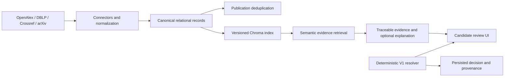

# Academic Metadata Aggregator and Author Resolution

This project aggregates scholarly publication metadata from OpenAlex, DBLP, Crossref, and arXiv, normalizes and deduplicates publication records, and provides an evidence-guided OpenAlex author-candidate review flow. Deterministic Author Resolution V1 remains the authority for identity decisions. A local semantic evidence index retrieves stored publication records and can produce citation-checked explanatory text; citation IDs and retrieval similarity do not prove that an explanation is factually supported or that an author identity is correct.

## Architecture



The relational database is the source of truth. Chroma is a rebuildable projection of canonical publications. The indexer is an explicit operation and is never triggered by ordinary search requests.

## Setup

Use the repository virtual environment when present, or create one with Python 3.11+:

```sh
python -m venv .venv
. .venv/bin/activate
python -m pip install -r backend/requirements.txt
cd frontend && npm ci && cd ..
```

Configure `backend/.env` from `backend/.env.example`. Keep provider credentials in the ignored local file or process environment; do not commit them. `DATABASE_URL` is relative to the process working directory, so run backend commands from `backend/` or set an absolute database URL explicitly. The repository currently contains separate root and backend SQLite histories; do not copy or migrate one over the other without reviewing [the baseline audit](docs/baseline-audit.md).

The backend database in this checkout is at Alembic revision `20260907_01`. For a new database, review the migration first and then run `cd backend && ../.venv/bin/alembic upgrade head`. Do not run that command against an existing database until its path and backup are verified.

## Run locally

From the repository root, in separate terminals:

```sh
cd backend && ../.venv/bin/uvicorn main:app --reload --port 8000
```

```sh
cd frontend && npm run dev
```

The API is available at `http://localhost:8000`; Vite proxies local API requests to it. `GET /health` reports API and circuit-breaker status.

Always start the backend from `backend/` as shown. The default `DATABASE_URL` is relative to the current working directory, so starting the same command from the repository root selects the separate legacy root database while the default vector index still points to `backend/vector_index/`.

Always start the backend from `backend/` as shown. The default `DATABASE_URL` is relative to the current working directory, so starting the same command from the repository root silently selects the separate legacy root database while the default vector index still points to `backend/vector_index/`.

## Build and query the evidence index

From `backend/`, using the selected database configured in `DATABASE_URL`:

```sh
../.venv/bin/python scripts/build_vector_index.py
```

This builds or reconciles `vector_index/` from canonical `publications`, upserts only changed content hashes, and removes stale index documents. It preserves canonical IDs, provider names, source-record IDs, DOI, title, abstract when present, year, venue, authors, source-reported concepts, publication affiliation mentions, URL, and index/model versions. Chroma uses its local `all-MiniLM-L6-v2` Sentence Transformers embedding function. Model assets are stored under the configured index path and may be downloaded on first build; change the persistent index path with `VECTOR_INDEX_PATH`.

API workflows:

- `POST /author-resolutions/candidates`: candidate hypotheses, retrieved local publication evidence, and an optional LLM explanation.
- `POST /evidence/search`: bounded top-k semantic retrieval with optional exact DOI/year/primary-source filters and citation-validated explanation.
- `POST /author-resolutions`: persist automatic, manual, or unresolved V1 outcome.
- `GET /author-resolutions/{resolution_id}`: inspect persisted decision and feature provenance.
- `GET /search?resolution_id=...`: run guarded publication search after a resolved or manually selected identity.

To enable generated explanations, set `GEMINI_API_KEY`, `GEMINI_MODEL`, and optionally `GEMINI_BASE_URL`. The client calls Gemini's native `generateContent` endpoint. The provider does not decide identity. If generation is unavailable, the API returns deterministic evidence text; if retrieval is unavailable, V1 remains usable. See [local provider setup and the explicit smoke command](docs/llm-provider.md); the smoke command is never run automatically.

## Tests and evaluation

```sh
cd backend && ../.venv/bin/python -m pytest tests -q
cd frontend && npm run build
```

The API workflow integration test uses a disposable SQLite database. The local browser workflow was exercised with mocked candidate and publication-source calls, the persistent Chroma index, and no LLM credentials; it covered candidate review, evidence display, manual selection, unresolved status, loading feedback, and source-failure handling. Live provider requests have not been verified in this environment.

The API workflow integration test uses a disposable SQLite database. The local browser workflow was exercised with mocked candidate and publication-source calls, the persistent Chroma index, and no LLM credentials; it covered candidate review, evidence display, manual selection, unresolved status, loading feedback, and source-failure handling. A live OpenAlex/source-provider and live LLM request have not been verified in this environment.

The current persisted resolution history and smoke outputs are not a sufficiently large, independently labelled benchmark. Read the limitations and dataset status in [docs/evaluation.md](docs/evaluation.md) before making performance claims. The paper draft in [docs/research-paper.md](docs/research-paper.md) distinguishes implemented functionality from outcomes that still need experiments.

See [API workflows](docs/api.md), [database and migrations](docs/database.md), [methodology](docs/methodology.md), [dataset notes](docs/evaluation/dataset.md), and [troubleshooting](docs/troubleshooting.md) for implementation details.

## Deployment

Deployment configuration and prerequisites are described in [docs/deployment.md](docs/deployment.md). The app has not been deployed or verified on a public host. Production requires a persistent database volume, a persistent or reproducibly rebuilt Chroma index, configured CORS origins, and provider secrets if LLM explanations are wanted.

## Known limitations

- Retrieval quality has not yet been measured against relevance labels; embedding similarity is not calibrated.
- Existing V1 decisions are preserved. Retrieval is exposed as corroborating publication context and does not alter V1 scores or automatic decisions.
- LLM generation is optional and cannot alter an identity decision. The provider's claim citations are checked against retrieved document IDs.
- Candidate-source failures return `503` and do not create an unresolved identity decision. An empty successful candidate response can still produce an unresolved outcome.
- Candidate-source failures return `503` and do not create an unresolved identity decision. An empty successful candidate response can still produce an unresolved outcome.
- The persisted manual decisions are a small, non-independent pilot and are not a held-out benchmark.
- Google Scholar enrichment is optional and may be blocked or rate-limited by the source.
- No public deployment has been verified.
- Candidate and resolution APIs persist data and currently rely on rate limits without user authentication; add host-level or application-session authentication before a public launch.