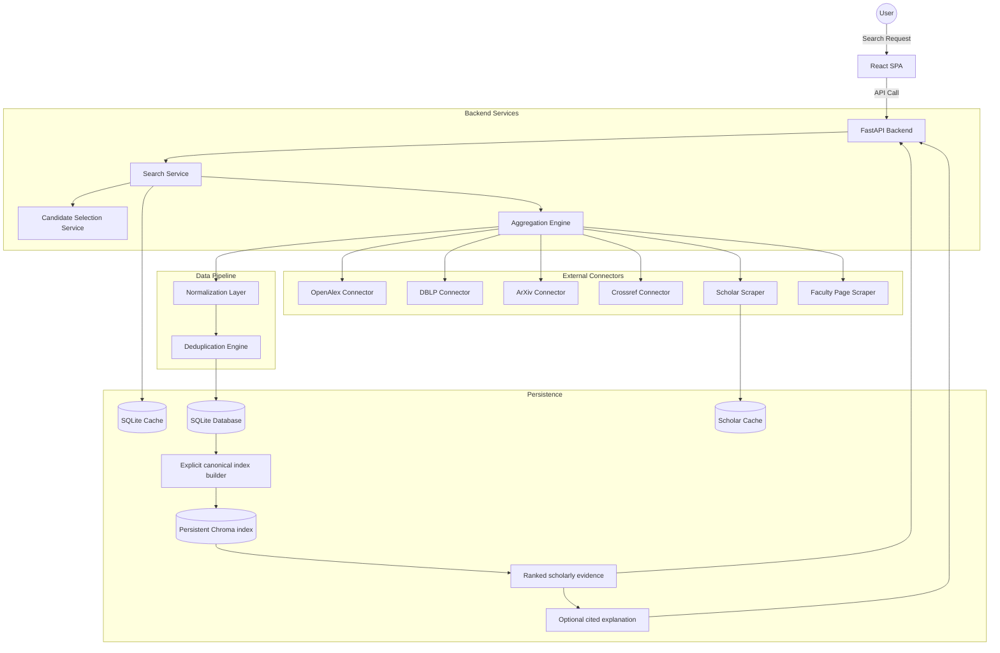

# System Architecture

The Hybrid Academic Metadata Aggregator is designed for high-precision author-centric search by fanning out queries to multiple bibliographic sources and merging them using a multi-stage deduplication pipeline.

## Component Overview

The Chroma collection is a rebuildable retrieval projection. The SQL database remains authoritative for publications, provenance, author candidates, and resolution decisions. `backend/scripts/build_vector_index.py` performs initial and incremental indexing; ordinary requests never re-index the corpus. Semantic hits are displayed as context and currently do not alter V1 scoring or identity decisions.

## Key Technologies
- **Frontend**: React, Vite, Vanilla CSS.
- **Backend**: Python, FastAPI, SQLAlchemy (Async).
- **Database**: SQLite (Development/Demo).
- **Scraping**: Playwright (Headless Chromium).
- **Deduplication**: RapidFuzz (Token-sort ratio).
- **Semantic evidence retrieval**: Chroma persistent collection with local `all-MiniLM-L6-v2` ONNX Sentence Transformers embeddings.
- **Explanation**: optional Gemini `generateContent` provider; generated claim document IDs are validated against retrieved hits, with deterministic fallback.
