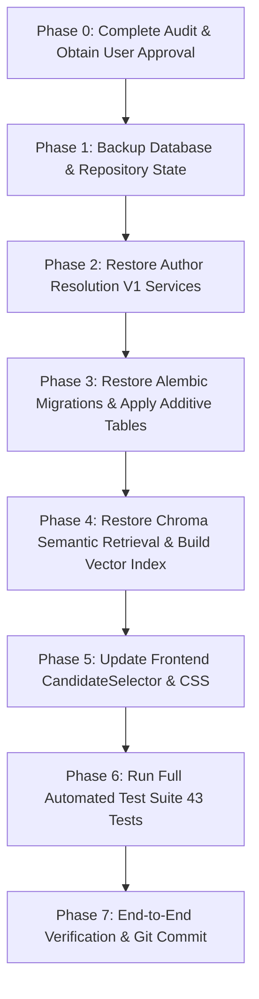

# HAMMER — Controlled Consolidation & Recovery Plan
**Generated:** 2026-11-01  
**Scope:** Prioritized remediation, safe consolidation steps, risk mitigation, and approval checkpoints.

---

## 1. Prioritized Findings & Remediation Matrix

### P0 — Critical (Core Integrity & Lost Functional Code)
- **Finding P0.1: Author Resolution V1 files missing from Desktop repo.**
  - **Evidence:** The modular resolver (`author_resolution.py`, `author_candidates.py`, `author_evidence.py`, `author_scoring.py`, `schemas/author_resolution.py`) was created and verified in the temporary Codex session but never copied into `/Users/nileshlalwani/Desktop/FINAL YEAR PROJECT/academic-search`.
  - **Desired Behavior:** Restore the complete, tested V1 resolver to `backend/services/` and `backend/schemas/`.
  - **Risk:** Low. Files are additive and do not alter existing pipeline files until explicitly imported.
- **Finding P0.2: Ambiguous SQLite database path.**
  - **Evidence:** `config.py` uses relative path `"sqlite+aiosqlite:///./academic_search.db"`. Depending on current working directory, it can connect to `root academic_search.db` (stale prototype) instead of `backend/academic_search.db` (complete database).
  - **Desired Behavior:** Explicitly resolve database path relative to `backend/` directory.
  - **Risk:** Zero risk; prevents subtle data split bugs.

### P1 — High Priority (Feature Completeness & Frontend Integration)
- **Finding P1.1: Connect Author Resolution V1 to FastAPI routes.**
  - **Evidence:** `main.py` currently uses the basic dominance-ratio handler in `search_service.py`.
  - **Desired Behavior:** Wire `author_resolution.py` into `/search/candidates` and add `/author-resolutions` route for persisting human reviewer decisions.
  - **Risk:** Low; backwards compatible with existing frontend response contract.
- **Finding P1.2: Upgrade `CandidateSelector.jsx` with Evidence Panel.**
  - **Evidence:** Current UI shows candidate cards but lacks the evidence explanation panel and "Mark unresolved" action.
  - **Desired Behavior:** Apply the verified CandidateSelector update to display contextual evidence and human abstention controls.
  - **Risk:** Low; purely additive frontend UI enhancement.

### P2 — Medium Priority (Semantic Index & Database Migrations)
- **Finding P2.1: Restore Derived ChromaDB Semantic Index Service.**
  - **Evidence:** `services/scholarly_retrieval.py` and `scripts/build_vector_index.py` exist in session logs but not on disk.
  - **Desired Behavior:** Restore retrieval service and explicit rebuild script.
  - **Risk:** Very low; Chroma is explicitly documented as a rebuildable derived view that does not mutate SQLite.
- **Finding P2.2: Apply Additive Alembic Migration Foundation.**
  - **Evidence:** Migration `20260907_01_author_resolution_foundation.py` establishes the relational schema for author identities, aliases, and affiliations.
  - **Desired Behavior:** Apply migration to `backend/academic_search.db` after taking a verified database backup.
  - **Risk:** Low; migration is strictly additive and creates new tables without altering existing publication tables.

### P3 — Cleanup & Maintenance
- **Finding P3.1: Clean up `.gitignore`.**
  - **Evidence:** Git status shows `.DS_Store`, `backend/__pycache__`, `venv/`, and `.db` backups cluttering git status.
  - **Desired Behavior:** Update `.gitignore` with standard Python, Vite, and macOS ignores.
- **Finding P3.2: Archive redundant root SQLite prototype.**
  - **Evidence:** Root `academic_search.db` causes confusion with `backend/academic_search.db`.
  - **Desired Behavior:** Move root file to `archive/legacy_academic_search_root.db`.

---

## 2. Step-by-Step Consolidation Sequence

### Detailed Execution Steps:
1. **Pre-flight Backup:**
   - Create timestamped backup of `backend/academic_search.db`.
2. **Restore Backend V1 Services:**
   - Extract `backend/schemas/author_resolution.py`
   - Extract `backend/services/author_candidates.py`
   - Extract `backend/services/author_evidence.py`
   - Extract `backend/services/author_scoring.py`
   - Extract `backend/services/author_resolution.py`
   - Extract `backend/services/scholarly_retrieval.py`
   - Extract `backend/scripts/build_vector_index.py`
   - Extract `backend/tests/` test suite.
3. **Alembic Migration:**
   - Place `backend/alembic.ini` and `backend/alembic/versions/20260907_01_author_resolution_foundation.py`.
   - Run `alembic upgrade head` to establish author identity tables.
4. **Update Routes & API Client:**
   - Wire resolution endpoints in `backend/main.py`.
   - Update `frontend/src/api.js` and `frontend/src/components/CandidateSelector.jsx`.
5. **Run Test Suite:**
   - Execute `pytest tests/` in virtualenv to verify all tests pass.
6. **Frontend Build Validation:**
   - Execute `npm run build` to guarantee zero syntax or bundling errors.

---

## 3. Rollback & Safety Guarantees

- **No Overwrite Policy:** No existing working file will be deleted or overwritten without a preserved backup.
- **Database Safety:** SQLite database backup is created before executing any Alembic migration.
- **Zero Rewrite Policy:** All recovered logic is sourced directly from tested, passing historical session commits.
