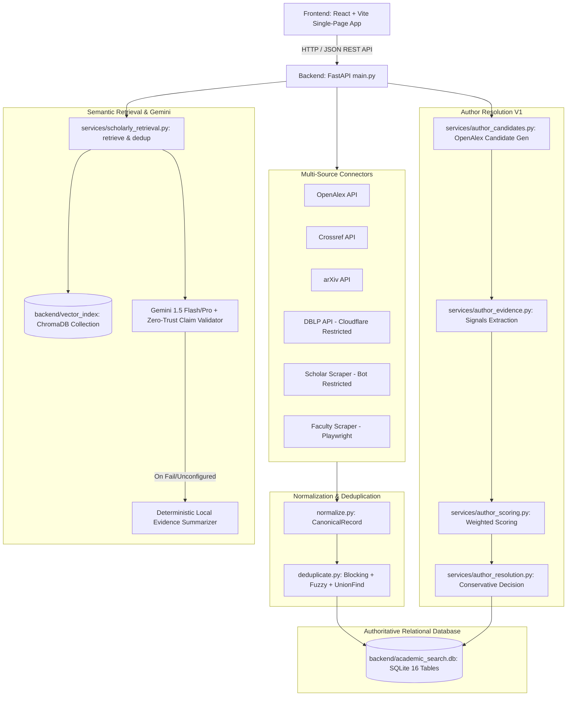

# HAMMER Phase 4: Subsystem Architecture & Dependency Map

**System:** HAMMER (Hybrid Academic Metadata & Entity Resolution)  
**Layer:** Architecture, Component Dependencies & Data Flow  

---

## 1. High-Level Subsystem Architecture

---

## 2. Component Dependency Table

| Module | Source Files | Depends On | Dependent Consumers | Role & Responsibility |
|---|---|---|---|---|
| **API Entry** | `backend/main.py` | `database.py`, `config.py`, `services/*` | Frontend (`api.js`) | FastAPI endpoints, request validation, error translation |
| **Relational DB** | `backend/database.py`, `alembic/` | SQLAlchemy, SQLite | All backend services | Authoritative record persistence (16 tables) |
| **Ingestion** | `backend/connectors/*` | `httpx`, `asyncio` | `search_service.py` | Multi-source academic harvest |
| **Deduplication** | `backend/pipeline/deduplicate.py` | `thefuzz`, `normalize.py` | `search_service.py` | Reversible clustering & canonicalization |
| **Author Candidates** | `services/author_candidates.py` | `httpx`, `database.py` | `main.py`, `author_resolution.py` | OpenAlex candidate generation & persistence |
| **Author Scoring** | `services/author_scoring.py` | `evidence.py`, `config.py` | `author_resolution.py` | Multi-signal weighted score calculation |
| **Author Resolver** | `services/author_resolution.py` | `scoring.py`, `config.py` | `main.py`, evaluation scripts | Conservative decision tree (margin, dominance) |
| **Vector Index** | `services/scholarly_retrieval.py` | `chromadb`, `sentence-transformers` | `main.py` | Dense vector similarity search & filtering |
| **LLM Provider** | `services/scholarly_retrieval.py` | `httpx`, Gemini REST API | `main.py` | Explanations with zero-trust claim validation |

---

## 3. Disconnected / Dead Code Analysis

- **`root_academic_search.db`:** Legacy 7-table database from Phase 1. Disconnected from active backend, preserved read-only as archive baseline.
- **`scholar_cache` / `circuit_breaker_state` tables:** Schema exists in SQLite; active connectors use in-memory circuit breaking or fallbacks.
- **DBLP / Scholar Connectors:** Kept disabled or optional by default due to Cloudflare challenges and upstream CAPTCHA blocks.
