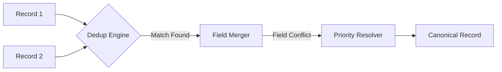

# Deduplication Pipeline

The system merges records from different sources using a multi-stage heuristic engine.

## Flow
1. **Exact DOI Match**: DOI is the strongest signal. If DOIs match, records are merged instantly.
2. **Exact Normalized Title Match**: Titles are stripped of punctuation and lowercase before comparison.
3. **Fuzzy Scoring**: If no exact match, we compute a weighted score:
    - **Title Similarity (60%)**: Token-sort ratio using RapidFuzz.
    - **Author Overlap (30%)**: Jaccard similarity of author last names.
    - **Year Match (10%)**: ±1 year tolerance.

## Source Priority
When merging fields (e.g., if two sources have different abstracts), we use `SOURCE_PRIORITY`:
1. **Scholar** (High quality abstracts/citations)
2. **OpenAlex** (Strong institutional metadata)
3. **Crossref** (Reliable DOIs)
4. **DBLP** (Computer Science specialty)
5. **ArXiv** (Pre-print details)

