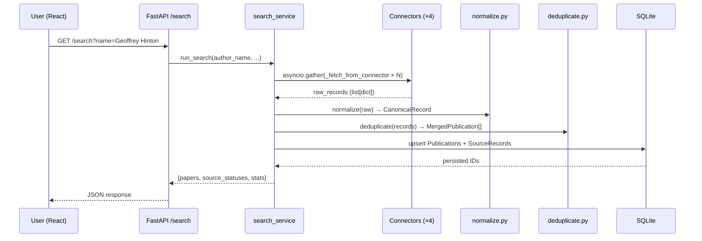
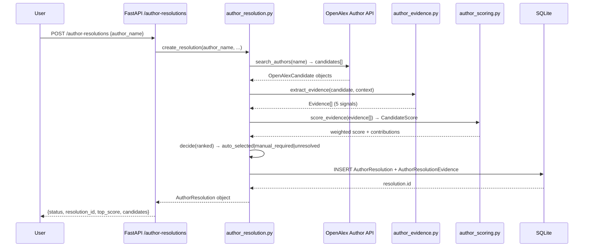
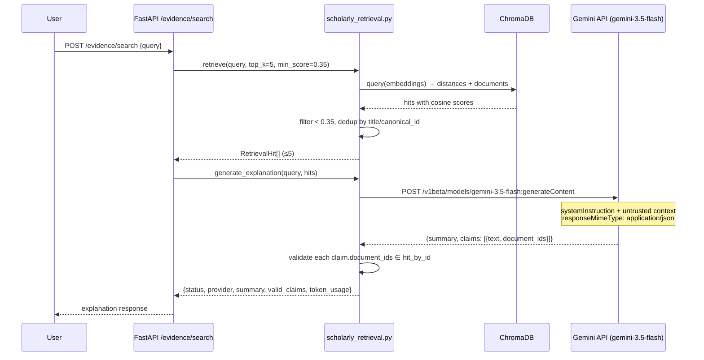

# HAMMER — Architecture Overview

## 1. System Purpose

HAMMER (Hybrid Academic Metadata & Entity Resolution) is a scholarly publication discovery system that aggregates records from multiple heterogeneous APIs, normalises and deduplicates them into canonical records, resolves ambiguous author identities using weighted multi-signal evidence, and explains retrieved evidence using a live Gemini LLM with zero-trust citation validation.

---

## 2. High-Level Component Map

```
┌─────────────────────────────────────────────────────────────────┐
│                         React Frontend                          │
│  SearchBar · PaperCard · CandidateSelector · SourceStatusPanel  │
└────────────────────────────┬────────────────────────────────────┘
                             │ HTTP REST (Vite → port 5173)
                             ▼
┌─────────────────────────────────────────────────────────────────┐
│                  FastAPI Application  (port 8000)               │
│  main.py  ·  rate_limiter  ·  circuit_breaker  ·  log_config   │
├─────────────┬──────────────┬──────────────────┬────────────────┤
│  /search    │  /evidence/  │  /author-        │  /metrics      │
│  GET        │  search POST │  resolutions     │  /similarity   │
│             │              │  POST            │  -log          │
└──────┬──────┴──────┬───────┴──────┬───────────┴────────────────┘
       │             │              │
       ▼             ▼              ▼
┌─────────────┐ ┌──────────────┐ ┌──────────────────────────────┐
│ search_     │ │ scholarly_   │ │  author_resolution.py        │
│ service.py  │ │ retrieval.py │ │  author_candidates.py        │
│             │ │              │ │  author_evidence.py          │
│ Orchestrates│ │ ChromaDB     │ │  author_scoring.py           │
│ connectors  │ │ dense search │ │                              │
│ + pipeline  │ │ + Gemini LLM │ │  OpenAlexCandidateService    │
└──────┬──────┘ └──────┬───────┘ └──────────────────────────────┘
       │               │
       ▼               ▼
┌──────────────────┐  ┌────────────────────────┐
│   Connectors     │  │  ChromaDB              │
│  openalex.py     │  │  vector_index/         │
│  dblp.py         │  │  449 embeddings        │
│  arxiv.py        │  │  all-MiniLM-L6-v2      │
│  crossref.py     │  └────────────────────────┘
│  scholar.py      │
│  faculty_scraper │
└──────┬───────────┘
       │
       ▼
┌────────────────────────────────────┐
│  Pipeline                          │
│  normalize.py  →  deduplicate.py  │
│  CanonicalRecord  →  MergedPub    │
└──────────────────┬─────────────────┘
                   │
                   ▼
┌─────────────────────────────────────────────────────────────────┐
│                  SQLite  (academic_search.db)                    │
│  16 tables · 454 publications · 2,053 source records            │
│  Author resolution history · Evidence audit trail               │
└─────────────────────────────────────────────────────────────────┘
```

---

## 3. End-to-End Request Flows

### 3a. Publication Search Flow



### 3b. Author Resolution Flow



### 3c. Evidence Explanation Flow (Gemini)



---

## 4. Technology Stack

| Layer | Technology | Version / Notes |
|-------|------------|-----------------|
| Backend framework | FastAPI | async, with SlowAPI rate limiting |
| ASGI server | Uvicorn | production-ready |
| ORM | SQLAlchemy 2 (async) | `AsyncSession`, mapped columns |
| Database | SQLite + aiosqlite | `academic_search.db`, 16 tables |
| Migration | Alembic | `alembic/versions/20260907_01_…` |
| Vector index | ChromaDB | `vector_index/`, 449 embeddings |
| Embedding model | `all-MiniLM-L6-v2` | SentenceTransformers, local |
| LLM provider | Google Gemini | `gemini-3.5-flash` via REST |
| HTTP client | httpx (async) | Gemini + external API calls |
| Fuzzy matching | rapidfuzz | dedup + evidence scoring |
| Frontend | React + Vite | port 5173 |
| Testing | pytest-asyncio | 55 tests, 100% pass |

---

## 5. Connector Source Priority

Crossref (1) → OpenAlex (2) → DBLP (3) → ArXiv (4) → Scholar (5) → Faculty Page (6)

Lower number = higher authority for field selection during merging.

---

## 6. Feature Flags (config.py)

| Flag | Default | Controls |
|------|---------|----------|
| `ENABLE_OPENALEX` | `true` | OpenAlex ingestion |
| `ENABLE_DBLP` | `true` | DBLP ingestion |
| `ENABLE_CROSSREF` | `true` | Crossref ingestion |
| `ENABLE_ARXIV` | `true` | ArXiv ingestion |
| `ENABLE_SCHOLAR` | `false` | Google Scholar (rate-limited) |
| `ENABLE_FACULTY` | `false` | Faculty page scraper |
| `DEMO_MODE` | `false` | Forces fast deterministic response |
