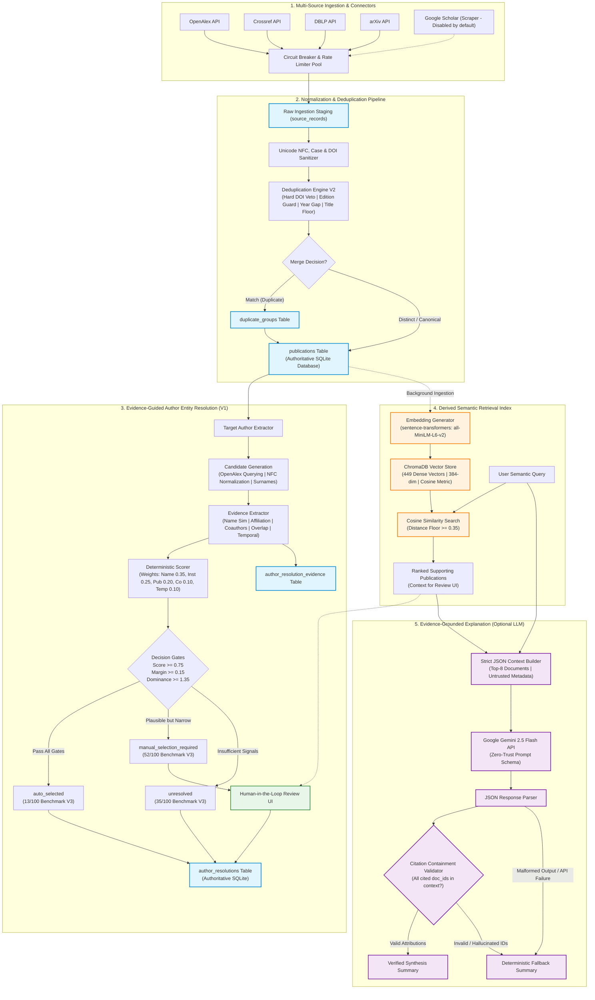

# HAMMER — System Architecture and Dataflow Specification

This document provides the formal architectural topology and dataflow diagrams for **HAMMER (Hybrid Academic Metadata Aggregator and Evidence-Guided Author Entity Resolution System)**, illustrating the strict operational separation between authoritative relational persistence, derived semantic indexing, and supplementary explanation generation.

---

## 1. End-to-End Pipeline Architecture

---

## 2. Core Architectural Invariants

1. **System of Record Invariance:** SQLite strictly owns identity truth (`publications`, `authors`, `author_resolutions`, `duplicate_groups`). ChromaDB is purely downstream and rebuildable.
2. **Decision Isolation Invariance:** Semantic dense retrieval results in ChromaDB are strictly visual/contextual aids for the human-in-the-loop review interface; they do not alter the deterministic scores or decision gates of Author Resolution V1.
3. **Safety Through Abstention:** Cases failing the conservative dominance (1.35) or score margin (0.15) thresholds are never forced into an automatic merge, routing instead to human adjudication (`manual_selection_required`) or preserved as `unresolved`.
4. **Citation Defense Invariance:** The explanation pipeline never accepts unverified document IDs; any hallucinated reference triggers claim sanitization or fallback to deterministic evidence summaries.
