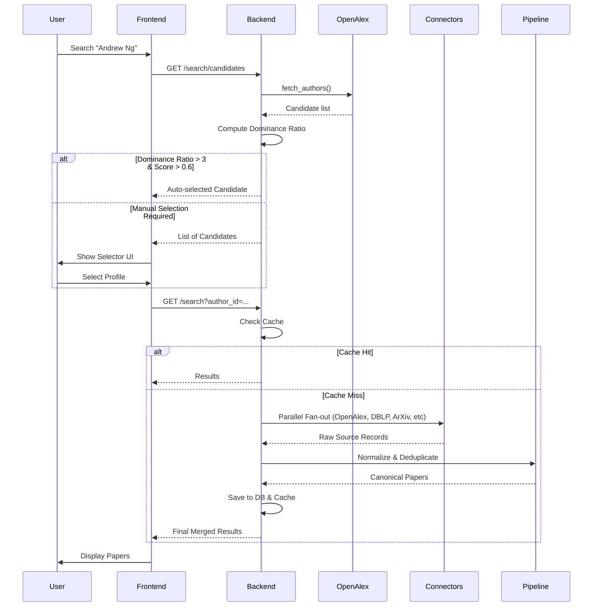

# Search & Identity Flow

The system employs a "Candidate First" approach to solve the author ambiguity problem (e.g., multiple "Andrew Ng").

## Dominance Ratio Formula
To determine if an author is "unambiguous", we use:
`dominance_ratio = (top_candidate_works) / (second_candidate_works + 1)`

If `dominance_ratio > 3` and the top score is high, we bypass manual selection.
